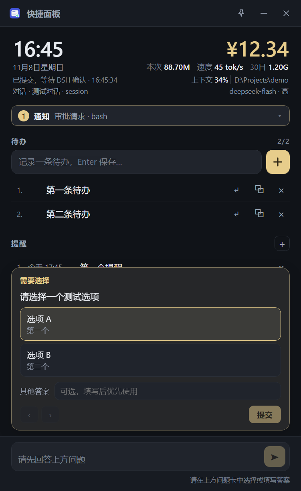

# 快捷面板 / Quick Panel

> 当前版本：1.0.5-beta.1（预发布）

[](https://github.com/cinewave0/cinewave0-dsh-quick-panel/actions/workflows/ci.yml)
[](https://github.com/cinewave0/cinewave0-dsh-quick-panel/releases)



DSH Desktop 的快捷面板插件：在 DSH 窗口内提供一个浮岛与面板，并附带一个可常驻桌面的独立小应用（Electron 伴生窗）。仓库已公开，通过 GitHub Releases 与 Discover 索引分发（npm 发布暂缓）。

- **DSH 内**：侧边栏入口 → 顶部浮岛 → 下拖面板；待办、提醒、实时消息、快速输入。
- **独立小应用**：默认顶部浮岛（360×48，置顶、不占任务栏），点开为 440 宽面板；托盘常驻；关闭面板只收起为浮岛。

## 环境要求

- Windows（独立小应用依赖 Electron 与 Windows 窗口 API）。
- DSH Desktop（Host 半区需要 `webServer` 与 `sessionController`）。
- Electron 43.x：独立窗由 Host 拉起一个外部 Electron 进程。**首次点“打开独立面板”时，Host 会自动下载、校验并安装 Electron 43.3.0（约 140 MB，win32 x64 / arm64）到 `%USERPROFILE%\.dsh\electron`，然后直接开窗。** 不需要 dsh-pet，也不需要手工解压。

  - 下载源：默认先走 npmmirror CDN，失败后回退 GitHub Releases；zip 的 SHA-256 固定在校验表里，镜像无法替换二进制。
  - 自定义镜像：`DSH_QUICK_PANEL_ELECTRON_MIRROR=https://your.mirror/electron`（该目录下需有 `43.3.0/electron-v43.3.0-win32-x64.zip` 或 `...-arm64.zip`）。
  - 已有 Electron：默认路径 `%USERPROFILE%\.dsh\electron\electron.exe`；也可以设置 `DSH_QUICK_PANEL_ELECTRON` 指向可执行文件（重启 DSH 生效）。
  - 离线/企业环境：设置 `DSH_QUICK_PANEL_NO_RUNTIME_DOWNLOAD=1` 关闭自动下载，再手动解压到 `%USERPROFILE%\.dsh\electron`。

## 安装

本插件目前走 **GitHub 分发**（npm 发布暂缓）。

> **安装或更新后必须完全退出 DSH 再打开**：托盘菜单 → 退出（或任务管理器结束 DSH 进程），确认进程消失后重新打开。只关闭窗口或刷新页面不会加载 Host 半区；首次安装时页面里的插件入口还没加载，看到“Host 未连接”不是插件坏了。Electron 运行时会在第一次打开独立面板时自动安装。

### 方式一：DSH 插件市场（Discover）

插件 → 发现 → 添加索引源：

```text
https://cinewave0.github.io/cinewave0-dsh-quick-panel/market/index.json
```

然后搜索 **Quick Panel** 安装 `1.0.5-beta.1`。索引固定到 v1.0.5-beta.1 的 Git commit。

> 索引当前指向预发布版；想用稳定版，用下面的 Release 包安装 `v1.0.4`。从任何版本升级都建议先完全退出 DSH 再装。

### 方式二：Release 包

从 [Releases](https://github.com/cinewave0/cinewave0-dsh-quick-panel/releases) 下载 `dsh-quick-panel-1.0.5-beta.1.tgz`，用 `SHA256SUMS` 校验，然后：

```powershell
dsh plugin --profile desktop add <下载目录>\dsh-quick-panel-1.0.5-beta.1.tgz
```

### 方式三：git commit

```powershell
dsh plugin --profile desktop add "git+https://github.com/cinewave0/cinewave0-dsh-quick-panel.git#6fbda1f6eb6b438907b45c7337c863ada8c8669b"
```

安装后：

- **修改 `client.js`、`panel/` 资源**：刷新 DSH 页面 / 重开独立窗；
- **修改 `index.js`（Host 半区）**：需要重启 DSH；
- **修改 `runtime/electron-helper/`**：托盘退出独立窗后重开。

开发目录仍可通过 `plugin_manager install_bundle target = <项目目录>` 以 link 方式挂载，详见「开发目录」。

## 使用

### DSH 内

- 侧边栏底部的快捷面板按钮打开浮岛；
- 浮岛显示最新一句 / 时间 / 运行呼吸灯；
- 点浮岛展开面板：待办、提醒、实时消息、底部快速输入；
- 待办左侧勾选 = 填入 DSH 输入框（不自动发送）；`↵` 在独立窗中填入输入框；
- 待办和提醒条目按当前显示顺序显示 `1.` `2.` 数字序号；
- 提醒支持翻页时钟、重复、提示音；
- 实时消息支持用户 / 助手 / 推理 / 代码 / 工具 / 错误、流式光标、上滚加载更早；
- 用户消息里的图片显示缩略图（Host 通过当前对话的附件引用读取，不在实时消息里传 base64）。

### 独立小应用

- DSH 面板底部的「打开独立面板」启动；默认先出现顶部浮岛；
- 点浮岛文字或 `⌃` 展开面板；拖动浮岛左侧 `⠿` 移动；
- 面板 X = 收起到浮岛；托盘菜单可打开面板 / 收起到浮岛 / 退出；
- 拖入图片或文件到窗口（底部输入框上方会出现附件条），上传完成后随下一条消息发送；单条最多 20 个附件，可逐个移除；
- 面板宽度固定 440，高度默认 720、可拖上下边缘；保留原生标题栏拖动和边框，不添加双击贴右、自定义拖动或热区；
- 用户消息缩略图可点击，在独立窗内查看原图（Esc 或点遮罩关闭）；
- 权限请求：DSH 页面可见时由 DSH 内建卡处理；DSH 页面隐藏/最小化时由独立窗接管，回到 DSH 可见后自动交还；
- DSH 的 1/2/3 选项问题会镜像到独立窗，选择/填写后可直接提交；
- DSH 不在对话页时，实时消息由 Host 继续镜像最近事件，并支持上滚加载更早；
- 「实时消息」与「在线」之间的 `+` 用于新建会话（等同侧边栏“新建会话”），后面 1–5 数字是最近 5 个会话（不显示标题），点数字即在 DSH 中切换；当前会话高亮，请求发出后目标按钮脉冲，等 DSH 页面轮询处理并回报；已归档会话不出现；
- 时钟右侧显示余额（与时钟同尺寸）和本次 token 总量、输出速度、最近 30 天 token 总量（日期字号）；
- 托盘退出才会真正结束小应用。

## 数据

- 共享存储：`%USERPROFILE%\.dsh\quick-panel\state.json`（待办、提醒、设置、当前会话 id）
- 窗口位置：`%USERPROFILE%\.dsh\quick-panel\window.json`
- 启动诊断：`%USERPROFILE%\.dsh\quick-panel\helper.log`
- DSH 面板的本地数据会在启动时迁移到 Host 存储；Host 不可用时回退 localStorage。

## 常见问题

**打不开独立面板**

- 第一次打开会先下载 Electron 运行时（约 140 MB），面板里会显示百分比；下载失败会写 `helper.log`，再点一次会重试；
- DSH 面板提示「Host 未连接」：Host 半区未加载，**完全退出 DSH 后重开**（托盘退出或结束进程，仅刷新页面不够）；
- 提示「需要 Electron」或「Electron 启动失败」：查看 `helper.log`，或设置 `DSH_QUICK_PANEL_ELECTRON` 指向已有的 `electron.exe`；
- 独立窗启动后立即消失：查看 `helper.log` 的 `did-fail-load` / `loadURL rejected` / 沙箱重试记录；
- 窗口已经开着时再点「打开独立面板」不会重复开窗，而是把已有窗口唤起（最小化也会恢复）。

**独立窗没有实时消息**

- 独立窗优先使用 DSH 对话页的实时镜像；离开对话页 5 秒后改用 Host 镜像；
- Host 镜像保留最近事件，上滚可加载更早；流式 partial 仍依赖 DSH 对话页；
- 如果完全没有消息，确认当前 DSH 对话与独立窗的「对话」标签一致。

**提醒不响**

- 首次使用需与页面交互一次以解锁音频；
- 独立窗打开时，DSH 面板的提醒到点逻辑会暂停，由独立窗处理；
- 独立窗关闭后，DSH 面板恢复提醒。

**从 link 开发切换到市场安装（Windows）**

`link` 安装会在 `%USERPROFILE%\.dsh\profiles\desktop\node_modules\dsh-quick-panel` 留一个 **junction** 指向项目目录。如果直接点市场安装，pnpm 会替换这个路径，可能**顺着 junction 删除项目目录里的文件**（包括 `.git`，表现为 `git status` 报 “not a git repository”）。

正确顺序：先在插件页卸载，再删掉残留链接，然后从市场安装：

```powershell
cmd /c rmdir "$env:USERPROFILE\.dsh\profiles\desktop\node_modules\dsh-quick-panel"
```

如果项目目录已经被误删：用 `git clone` 或之前的备份恢复，再把 `.git` 元数据补回；工作树文件通常只是被部分清理，先别覆盖备份。

## 已知限制

- 仅 Windows；独立小应用依赖 DSH 运行，Electron 首次打开时自动下载到 `%USERPROFILE%\.dsh\electron`（需要网络，约 140 MB）；离线环境设 `DSH_QUICK_PANEL_NO_RUNTIME_DOWNLOAD=1` 并手动安装；
- 自动安装覆盖 `win32-x64` 与 `win32-arm64`；其他架构会提示 `runtime-unavailable`，需要手动放置 `electron.exe`；
- 独立窗实时消息：Host 能在 DSH 离开对话页后继续镜像新的已结算事件，并在上滚时从 Host 会话事件加载更早；流式 partial 仍依赖 DSH 对话页；
- 独立窗问题卡：当前会话的 pending 问题会镜像；多题用上一题/下一题，提交后等待 DSH 确认；
- 独立窗会话切换/新建：`+` 与数字按钮只负责发起请求，真正的建会话/切换发生在 DSH 页面内的客户端插件；正常情况通过 SSE 立即送达，页面隐藏/最小化时回退到轮询（Chromium 会把定时器节流到约一分钟），请求保留 5 分钟，恢复窗口后立即执行；DSH 页面关闭或插件未加载时请求会在 5 分钟后过期；
- 图片缩略图：DSH 面板覆盖已加载的历史消息；独立窗覆盖 Host 镜像的当前窗口；原图由 Host 按附件引用按需读取，超过 16 MiB 的附件不预览；
- 通知中心：面板时钟下方常驻通知条，记录**审批请求、轮次结束、提醒到点**；未读显示角标，点开查看最近 20 条，审批条目可跳回审批卡，支持一键清空。记录存在面板 localStorage（DSH 重启换端口会清空）。
- 权限批准卡：默认在 DSH 页面可见时显示 DSH 内建卡；DSH 页面隐藏、独立窗心跳在线且当前对话匹配时由外部面板接管。外部面板「实时消息」下方的**审批锁定在外部面板**勾选后，即使 DSH 可见也由外部面板接管；取消勾选恢复 DSH 内建审批。审批被接管时面板会响提示音并弹桌面通知（标题含工具名，回答后通知关闭）。关闭独立窗或心跳丢失时始终交还 DSH；不再有 120 秒超时兜底；
- 时间栏的“30 日”是本机 DSH 会话投影的近似总量（含缓存读取），不是平台账单；余额需要已登录 DeepSeek 账号，API Key 模式显示 `—`，余额缓存约 5 分钟；
- 多显示器/跨 DPI 场景未完整验证；
- 独立窗提醒与 DSH 面板的“单一负责人”协调仍在完善。

## 更新日志

### 1.0.5-beta.1（2026-11-10）

- 「实时消息」标题栏新增 `+`：新建会话（等同侧边栏“新建会话”），位于 1–5 数字之前；
- 会话切换/新建改由 Host 通过 SSE 推送，不再依赖 2.5 秒轮询；DSH 最小化时定时器被节流也能立即响应；
- 请求保留时间 30 秒 → 5 分钟，窗口恢复可见时立即补执行；等待期间面板显示「等待 DSH 页面响应…」。

### 1.0.4（2026-11-09）

- 首次打开独立面板自动下载、校验并安装 Electron 43.3.0（win32 x64 / arm64），不再依赖 dsh-pet 或手工解压；镜像/离线环境变量见「环境要求」；
- 独立窗启动健壮性：等页面首次 ping 才算开窗成功、已开窗时唤起、非 loopback 地址拒绝、Electron stderr 写入 `helper.log` 并轮转；
- 安装或升级后未重启时，面板顶部提示「插件已安装，需要重启 DSH」（完全退出，而不是刷新）；
- 下载进度与失败原因按错误码显示，`/quick-panel/runtime` 暴露安装状态；
- 「实时消息」标题栏的 1–5 数字切换最近会话（beta.1 起）；
- 锁文件改用公共 npm registry，CI/Release 增加市场索引与版本一致性的校验。

## 开发目录

```
index.js                     Host：共享存储、本地 API（含图片附件读取）、live、prompt/stop、静态资源
client.js                    DSH 客户端（构建产物；编辑 src/client/ 后重新构建）
src/client/main.js           DSH 客户端入口：apply 与槽位注册
src/client/dsh.js            DSH 服务适配层（能力检测 + 降级）
src/client/session.js        store/模式/待办/提醒/HostSync
src/client/overlay.js 等     组件与工具模块（overlay/sections/feed/input/panel/bridges）
src/client/runtime.js        React 绑定（DSH 的 require('react') 注入）
panel/                       独立窗页面（HTML/CSS/JS/icon）
runtime/electron-helper/     独立窗主进程与 preload
locale/                      插件标题/描述
scripts/                     构建、备份、GitHub 同步、市场索引生成/校验
test/                        Host 回归、客户端 bundle/适配层/源码导入、运行时安装、Electron 面板测试
```

## 开发命令

```powershell
node scripts/build-client.mjs                    # 由 src/client 生成 client.js
node test/host.test.mjs                          # Host 回归（17 项）
node test/client-bundle.test.mjs                 # 客户端 bundle 信封/工厂形状
node test/dsh-adapter.test.mjs                   # DSH 服务适配层与降级路径
node test/source-imports.test.mjs                # 源码模块导入完整性
node test/runtime-install.test.mjs               # 首次安装 Electron（Windows，真实解压）
node test/restart-prompt.test.mjs                # 重启提示文案
node test/helper.test.mjs                        # 真实 Electron helper 启动冒烟（需 electron.exe）
node test/panel.test.mjs                         # Electron 面板集成测试（需 electron.exe）
npm run check:market                             # 市场索引指向的 commit 与版本一致
npm run lint                                     # oxlint（0 warning 门槛）
node scripts/backup.mjs                          # 备份到 ../backups（zip + sha256 + manifest）
node scripts/sync-github.mjs --message "..."     # 提交 + 测试 + push
node scripts/sync-github.mjs --dry-run           # 只看计划，不提交不推送
node scripts/sync-github.mjs --proxy http://127.0.0.1:7897 --message "..."  # 直连被重置时走本机代理
```

`client.js` 是生成文件，直接改它会在下一次构建时被覆盖；CI 会用 `git diff --exit-code client.js` 检查源码与产物是否一致。

## License

MIT
